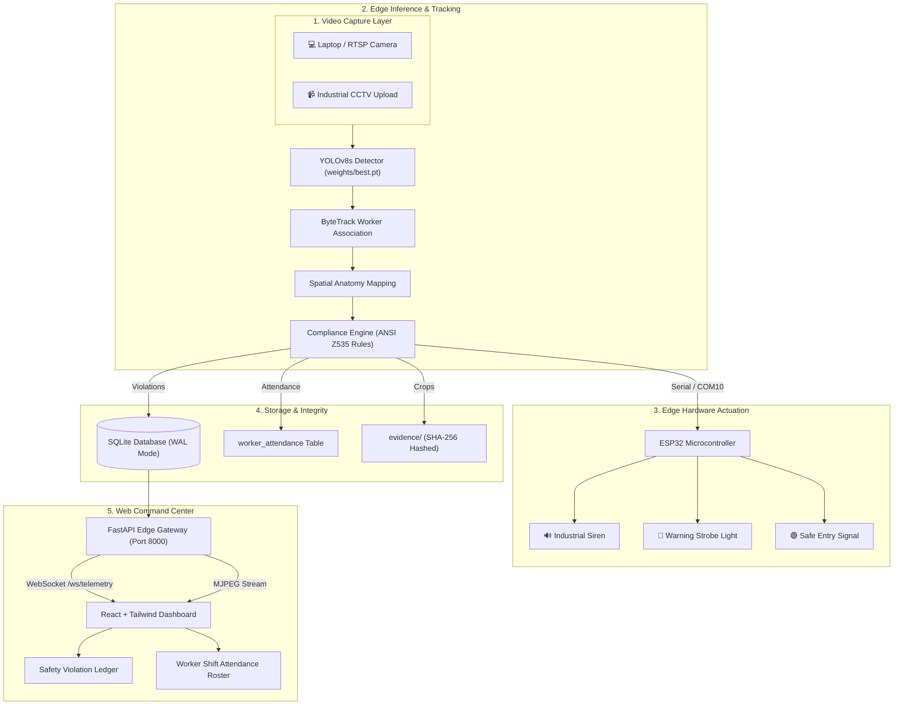

<div align="center">

# 🦺 Industrial PPE Safety Intelligence Platform (IPSIP)
### Real-Time Deep Learning Computer Vision &bull; Edge Hardware Bridge &bull; Automated Attendance &bull; OSHA / ISO 45001 Compliance

[](https://www.python.org/)
[](https://fastapi.tiangolo.com)
[](https://github.com/ultralytics/ultralytics)
[](https://reactjs.org/)
[](https://www.espressif.com/)
[](LICENSE)

An end-to-end industrial edge computing safety surveillance system designed to detect Personal Protective Equipment (PPE) compliance in real-time. Built with fine-tuned **YOLOv8**, **ByteTrack** multi-worker tracking, anatomical **spatial association**, an **OSHA/ANSI Z535 rule engine**, an **automated shift attendance registry**, and physical **ESP32 microcontroller actuation** (buzzer & strobe alerts).

[Key Features](#-key-features) &bull;
[System Architecture](#-system-architecture) &bull;
[Quick Start](#-quick-start) &bull;
[Hardware Setup](#-hardware-integration-esp32) &bull;
[REST API & Telemetry](#-rest-api--websocket-telemetry) &bull;
[Audit Reports](#-compliance-audits--reporting)

</div>

---

## 📸 Platform Overview

The system runs a low-latency surveillance command center that operates seamlessly with live laptop webcams, industrial IP cameras, or uploaded CCTV footage:

- **Live Video Viewport**: Zero-lag MJPEG stream with dynamic bounding boxes, worker IDs, and PPE classification confidence badges.
- **Dynamic 4-Item PPE Checklist**: Real-time status badges for ⛑️ Helmet, 🦺 High-Vis Vest, 🥾 Safety Boots, and 🧤 Protective Gloves.
- **Dual-Mode Right Command Panel**:
  - 🚨 **Safety Violations Ledger**: Live incident triage queue with evidence snapshots, SHA-256 verification hashes, and officer action workflows (`CONFIRMED`, `DISMISSED`, `FALSE_POSITIVE`).
  - 👷 **Shift Attendance & PPE Registry**: Automated shift roster logging In-Time, Out-Time, Dwell Duration, PPE Verification Score, and Pass/Flag compliance status for every worker.
- **Operational KPIs & Telemetry**: Live compliance rate percentage, worker count, violation breakdown charts, and camera FPS counters.
- **Hardware Status**: Microcontroller heartbeat monitoring, active-low/high buzzer polarity toggle, and serial auto-reconnect.

---

## ⚡ Key Features

| Capability | Technical Details |
|---|---|
| **Deep Learning Detection** | Custom fine-tuned **YOLOv8s (`ppe_exp_v3`)** model detecting 11 classes (hard hats, safety vests, protective gloves, steel-toe boots, safety goggles, and hard-negative person/no-gear classes). Verified **0.83–0.85 helmet confidence** on real-world edge framing. |
| **Multi-Worker Tracking** | **ByteTrack** wrapper assigning persistent track IDs across temporary occlusions, camera pan, and overlapping paths without identity switching. |
| **Anatomical Spatial Association** | Dynamic bounding-box association algorithm mapping detected PPE to specific body regions of detected workers with margin-tolerant head tilt compensation. |
| **Temporal Compliance Engine** | Stateful compliance state machines enforcing configurable confirmation windows ($N$-frame confirmation + cooldown guards) to eliminate momentary occlusion false alarms. |
| **Shift Attendance Registry** | Tracks workforce presence with In-Time, Out-Time, calculated Dwell Duration, and real-time **PPE Verification Score** ($\frac{\text{Compliant Frames}}{\text{Observed Frames}} \times 100\%$). |
| **Physical ESP32 Actuation** | Hardware serial bridge firing sub-50ms buzzer and strobe relays upon confirmed violations, compliant LED signals, and rate-limited auto-reconnect logic that never blocks camera capture if unplugged. |
| **1-Click CCTV Stream Inspector** | Upload custom `.mp4 / .avi / .mov` industrial footage or choose from 4 preloaded plant clips to stream annotated detections in real-time with parallel ESP32 and database execution. |
| **Tamper-Proof Audit Exports** | Download official compliance logs in **PDF** (printable executive summary), **Microsoft Excel** (`.xls` with conditional formatting), and standard **CSV**. |

---

## 🏗️ System Architecture



---

## 📁 Repository Structure

```text
├── config/                          # Plant zone policies and PPE requirement rules
│   └── zones.yaml                   # Safety zones, required PPE, confirmation thresholds
├── esp32_firmware/                  # Microcontroller firmware
│   └── esp32_firmware.ino           # Arduino/ESP32 serial command handler and GPIO driver
├── evidence/                        # Tamper-proof cropped violation & attendance images
├── frontend/                        # React + Vite + Tailwind CSS industrial dashboard
│   ├── src/
│   │   ├── components/
│   │   │   ├── AnalyticsOverview.jsx # Operational KPI cards & PPE breakdown charts
│   │   │   ├── AttendanceRoster.jsx  # Shift workforce attendance roster & snapshot modal
│   │   │   ├── CameraFeed.jsx        # Live camera MJPEG viewport & 4-item checklist
│   │   │   ├── EvidenceModal.jsx     # High-resolution evidence snapshot inspector
│   │   │   ├── Header.jsx            # System branding, clock, and audit export buttons
│   │   │   ├── IncidentQueue.jsx     # Safety violation triage queue
│   │   │   ├── PolicyConfigModal.jsx # Dynamic safety zone policy configuration
│   │   │   └── VideoUploadModal.jsx  # CCTV upload & 1-click sample demo clip selector
│   │   ├── services/api.js          # REST API & WebSocket client
│   │   ├── App.jsx                  # Main command center layout
│   │   └── main.jsx                 # React root entry point
│   ├── dist/                        # Pre-compiled production distribution (static build)
│   └── package.json                 # Frontend dependencies
├── ppe_monitor/                     # Core safety intelligence Python package
│   ├── api/
│   │   ├── live_stream.py           # Zero-lag DirectShow camera grabber & live pipeline
│   │   ├── main.py                  # FastAPI application, WebSocket broadcaster & REST routes
│   │   └── pdf_report.py            # Professional PDF compliance audit generator
│   └── ppe_monitor/
│       ├── compliance/              # Policy loaders, temporal state machines, and rules
│       ├── detector/                # YOLOv8 multi-class detection wrapper & thresholds
│       ├── display/                 # High-performance OpenCV HUD overlay visualizer
│       ├── messaging/               # ESP32 serial bridge & MQTT client
│       ├── persistence/             # Thread-safe SQLite event & attendance database
│       └── tracker/                 # ByteTrack wrapper & anatomical spatial association
├── uploads/                         # Preloaded industrial test videos & uploaded clips
├── weights/                         # Pre-trained & fine-tuned neural network models
│   └── best.pt                      # Fine-tuned YOLOv8s production weights (22.5 MB)
├── main.py                          # Unified server entry point (FastAPI + Static UI)
├── requirements.txt                 # Python dependencies
├── run_dashboard.bat                # Windows 1-click startup batch script
└── README.md                        # Project documentation
```

---

## 🚀 Quick Start

### 1. Prerequisites
- **Python**: 3.10, 3.11, or 3.12 installed.
- **Camera**: Standard USB webcam, laptop integrated camera, or IP camera (optional).
- **Node.js**: (Optional) Only needed if modifying frontend code; pre-built production UI is included in `frontend/dist`.

### 2. Installation
Clone the repository and install the dependencies:

```bash
git clone https://github.com/Prakshil/Industrial-PPE-Detection-System.git
cd Industrial-PPE-Detection-System

# Create virtual environment
python -m venv venv

# Activate virtual environment
# Windows (PowerShell):
.\venv\Scripts\Activate.ps1
# Linux / macOS:
source venv/bin/activate

# Install dependencies
pip install -r requirements.txt
```

### 3. Launch the Platform
Start the unified edge server:

```bash
python main.py
```

*Or double-click `run_dashboard.bat` on Windows.*

Open your web browser and navigate to:
```
http://127.0.0.1:8000
```

---

## 🛠️ Hardware Integration (ESP32)

The system includes a bi-directional serial bridge communicating over USB/UART at **115200 baud**:

```
[Edge PC / Jetson]  ==== USB Serial (COM10 / /dev/ttyUSB0) ====  [ESP32 Development Board]
                                                                     │
                                                 ┌───────────────────┼───────────────────┐
                                                 ▼                   ▼                   ▼
                                            [GPIO 2]            [GPIO 4]            [GPIO 5]
                                         Status Green LED      Active Buzzer      Warning Strobe
```

### Serial Protocol Commands
| Command Sent | System Trigger | Hardware Reaction |
|---|---|---|
| `V:<track_id>:<ppe>\n` | Confirmed PPE violation | Buzzer sounds pulsed alarm; strobe relay engages |
| `P\n` | Pending verification ($N$-frames accumulating) | Warning indicator blinks |
| `C\n` | All tracked workers compliant | Solid Green Safe LED; buzzer silenced |
| `I\n` | No workers in frame | Standby LED pulse; relays disengaged |

*Note: The platform functions completely standalone if the ESP32 is not plugged in. The serial bridge uses non-blocking 5-second backoff reconnects that never freeze camera capture.*

---

## 🌐 REST API & WebSocket Telemetry

The FastAPI backend provides a comprehensive industrial REST API:

### Live Camera & Video Stream
- `GET  /api/v1/health` — System health, database status, and uptime.
- `POST /api/v1/camera/live/start` — Start webcam capture & YOLO edge inference.
- `POST /api/v1/camera/live/stop` — Stop webcam capture safely.
- `GET  /api/v1/camera/live/status` — Current FPS, tracked workers, and live checklist.
- `GET  /api/v1/stream/feed` — Multipart MJPEG stream with dynamic bounding boxes.
- `POST /api/v1/video/start-stream` — Stream an uploaded video or preloaded sample clip.
- `GET  /api/v1/videos/sample-list` — List preloaded CCTV clips for 1-click evaluation.

### Worker Attendance & Shift Roster
- `GET  /api/v1/attendance` — Retrieve worker shift roster with dwell duration & pass scores.
- `DELETE /api/v1/attendance` — Reset shift attendance ledger.
- `GET  /api/v1/export/attendance?format=csv|excel` — Export workforce attendance roster.

### Safety Violations & Triage
- `GET  /api/v1/violations` — Paginated list of confirmed violation events.
- `PATCH /api/v1/violations/{id}/action` — Triage incident (`CONFIRMED`, `DISMISSED`, `FALSE_POSITIVE`).
- `DELETE /api/v1/violations/{id}` — Delete single violation record.
- `GET  /api/v1/evidence/{filename}` — Serve high-resolution cropped evidence snapshot.
- `GET  /api/v1/export/audit?format=pdf|excel|csv` — Export official compliance audit log.

### Real-Time WebSocket Feed
- **URL**: `ws://127.0.0.1:8000/ws/telemetry`
- **Rate**: Broadcasts every 400ms.
- **Payload Schema**:
```json
{
  "type": "telemetry_tick",
  "timestamp": 1795538926.23,
  "zone_id": "active_work_zone",
  "fps": 28.5,
  "active_workers": 2,
  "compliant_count": 1,
  "violation_count": 1,
  "workers": [
    {
      "track_id": 1,
      "status": "COMPLIANT",
      "checklist": {
        "helmet": { "present": true, "confidence": 0.86 },
        "vest": { "present": true, "confidence": 0.91 }
      }
    }
  ],
  "attendance_summary": {
    "total_workers": 5,
    "passed_workers": 4,
    "flagged_workers": 1,
    "pass_rate_percent": 80.0
  }
}
```

---

## 📊 Compliance Audits & Reporting

The system maintains an immutable local audit ledger stored in SQLite WAL mode:
1. **OSHA 1910.132 & ISO 45001 Compliance Report (PDF)**: Includes executive summaries, violation severity distributions, zone breakdowns, and citations.
2. **Formatted Microsoft Excel Spreadsheet (`.xls`)**: Pre-styled spreadsheet with color-coded status badges, formatted date columns, and SHA-256 evidence verification hashes.
3. **Audit Trail CSV**: Standard RFC 4180 CSV export for direct ingestion into enterprise SIEM or ERP systems.

---

## 📜 Compliance Standards

This platform implements safety standards aligned with:
- **OSHA 29 CFR 1910.132**: General Personal Protective Equipment requirements.
- **OSHA 29 CFR 1926.100**: Head protection on construction and industrial sites.
- **ANSI/ISEA Z89.1**: Industrial head protection performance criteria.
- **ANSI/ISEA 107**: High-visibility safety apparel standards.
- **ISO 45001**: Occupational health and safety management systems.

---

## 👥 Contributors & Acknowledgements
- Developed for Project Semester 7.
- Ultralytics YOLOv8 team for model architectures.
- ByteTrack authors for the multi-object tracking foundation.
